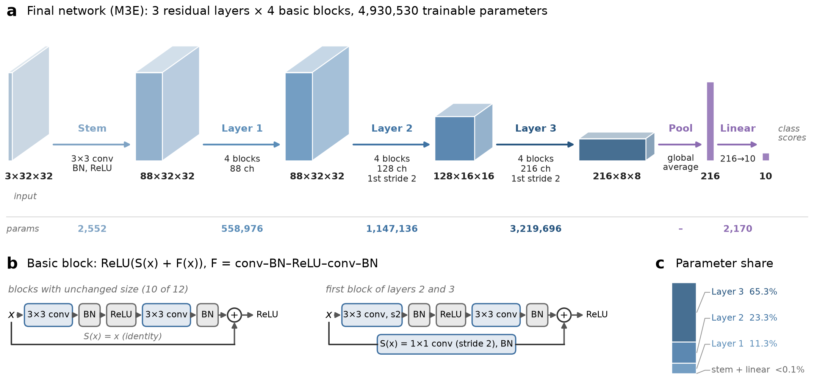
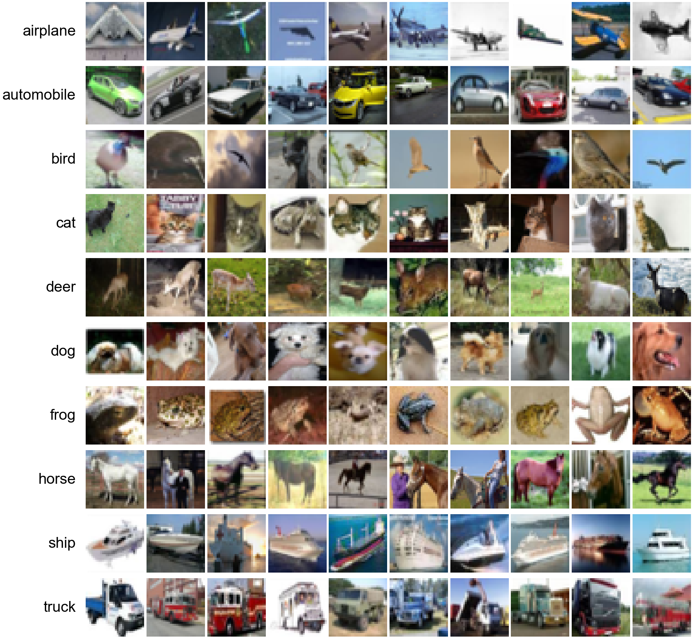
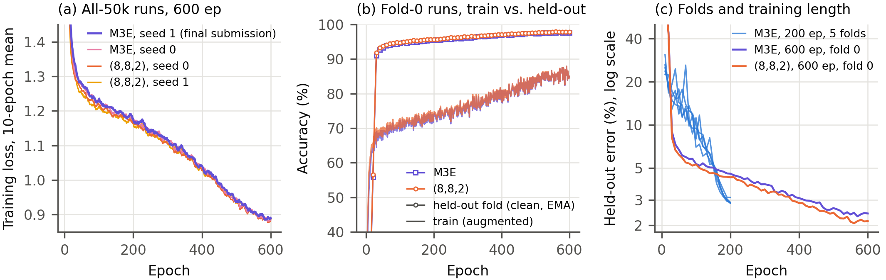
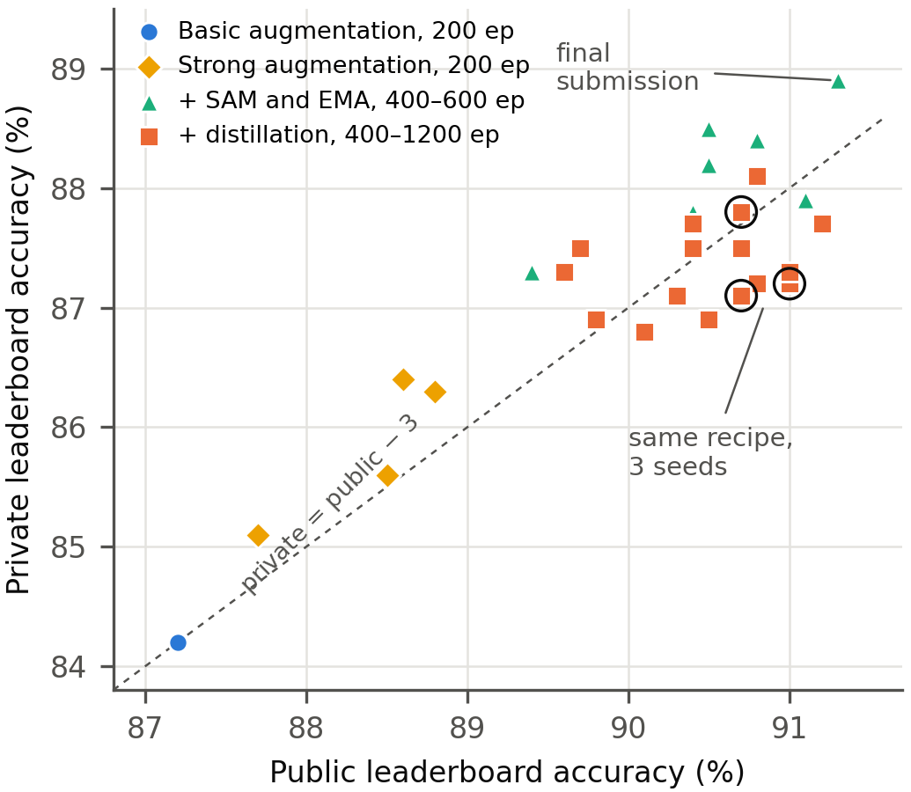
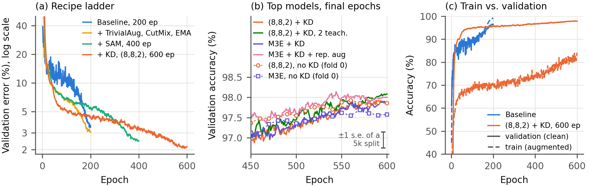

# CIFAR-10 ResNet under 5M parameters (ECE7123 Project 1)

A residual network with **4,930,530 parameters** (limit: 5M), trained from scratch on CIFAR-10 for a Kaggle competition whose
2,000-image test set comes from a *different distribution* than the training data: its images are brighter, higher in contrast
and three times as likely to be grayscale. Our final model scores **91.3% on the public and 88.9% on the private leaderboard**
(our first baseline scored 87.2% public). By Zuzanna Bak and Moses Bakst, New York University, Tandon School of Engineering.

**The final model (M3E).** A 3×3 stem, then three residual layers of four basic blocks each (widths 88, 128, 216; stride 2 at the start of
layers 2 and 3), global average pooling and a linear layer. Blocks are `ReLU(S(x) + F(x))` with `F` = conv-BN-ReLU-conv-BN.
It was trained for 600 epochs on all 50,000 images with TrivialAugment, CutMix, repeated augmentation, sharpness-aware minimization
(SAM, rho 0.05), label smoothing 0.1 and weight averaging (EMA 0.999), and predicts with flip test-time augmentation.
No pretrained weights, no extra data, and test images are used only for the final prediction.

| Model | Params | Public | Private |
|---|---|---|---|
| Baseline (3,3,3) ResNet, basic augmentation, 200 epochs | 4.33M | 87.2 | 84.2 |
| + TrivialAugment, CutMix, EMA, SAM, 400 epochs | 4.33M | 89.4 | 87.3 |
| **M3E, 600 epochs, seed 1 (final)** | **4.93M** | **91.3** | **88.9** |
| M3E distilled from a WRN-28-10 teacher (`kd_pipeline/`) | 4.93M | 91.2 | 87.7 |

**What we found.** Most of the gain came from the training recipe (strong augmentation, SAM, longer training), not from the network shape.
Knowledge distillation, stochastic depth, squeeze-and-excitation, test-time batch-norm adaptation and class rebalancing gave no measurable
improvement. Above about 97.5% held-out accuracy, validation no longer predicted the leaderboard order, and seed-to-seed noise
(0.3 points public, 0.7 private) was as large as most of the differences between our late submissions.

### The data

Ten random training images per class (32×32 RGB). The training set also contains near-duplicate images (one car appears 54 times)
and many late-2000s internet memes, so cross-validation folds keep duplicate groups together
(`exploration/dedup_transforms.py`).

### Training and results

Training curves of the final recipe: training loss of the runs on all 50,000 images (the submitted model is the thick line), and
accuracy on augmented training images and held-out data for the fold-0 twin.

Public against private leaderboard accuracy of our submissions. Private scores were 2-4 points lower, and the public ranking only
partly carried over.

Held-out error across the recipe ladder (pipeline A, 45k/5k split). `kd_pipeline/` holds the second pipeline (distillation) with its
own `train.py`, recipe and checkpoint.

---

Design decisions, with evidence and sources, are in `decisions.md`; the test-set provenance notes are in `data_provenance.md`.

**Final model:** `final_model.ipynb` loads the submitted weights (`results/final_model/`), prints the parameter
count (4,930,530) and reproduces the Kaggle test predictions; test accuracy 88.9% (private leaderboard), 91.3% (public).

## Layout

| Path | Stage | Contents |
|---|---|---|
| `src/config.py` | all | constants and data-layer defaults (row ids refer to `decisions.md`) |
| `src/extract.py` | E1, E3 | verify the Kaggle files, decode them into `data/cache_uint8.npz` |
| `exploration/dedup_transforms.py` | E2 | transform-invariant duplicate search → `data/dup_groups*.npy` |
| `src/folds.py` | L1 | stratified, grouped 5-fold split → `data/folds.npy` |
| `src/transform.py` | T1–T7 | GPU augmentation (incl. renditions), normalization, Cutout, CutMix |
| `src/load.py` | L1–L5 | splits, seeded generators, training batch stream, run registry |
| `src/shiftsets.py` | L6 | robustness evaluation sets (depiction + distractor) from held-out images |
| `src/model.py` | M1–M3 | configurable ResNet in the spec's design variables |
| `src/train.py` | R1 | one training run: logs, checkpoints/resume, final evaluation, metrics with provenance |
| `src/inference.py` | I1–I3 | TTA prediction, shift-mimic evaluation set, submission writing/validation/log |
| `src/launch.py`, `slurm/` | L5 | expand an experiment into runs; Slurm array script for NYU Burst |
| `src/registry.py` | L5 | pull run outputs from Drive, build `results/runs.csv` |
| `src/submit.py` | I3 | build + validate + log + submit a Kaggle submission from one run |
| `experiment.py` | — | every experiment (arms × folds) ever run |
| `colab/run.ipynb` | — | run an experiment on a Colab GPU from a pinned commit |
| `exploration/` | — | data analysis scripts and figures |
| `kd_pipeline/` | — | distilled M3E student (public 0.912): self-contained `train.py`, checkpoint, recipe (see its README) |

## Where things live

This project folder (on the laptop) is the home base: every file of record lives here.

| What | Home (source of truth) | Other copies |
|---|---|---|
| Code, configs, decisions, notebooks | this folder, versioned in git | GitHub = backup + what compute machines clone (pinned commit) |
| Data cache `cache_uint8.npz` (162 MB, immutable) | `data/` here | Drive `cifar/data/` for Colab; checksum in `data/SHA256SUMS` |
| Run outputs `runs/<config-hash>/` (weights, preds, metrics, logs) | `runs/` here | Drive `cifar/runs/` = Colab's working area; Burst `/scratch` = Burst's; both copied here by `src/registry.py` |
| Results table | `results/runs.csv` (git) | regenerated from `runs/` |
| Submissions | `submissions/*.csv` + `submissions.csv` (git) | every submission tied to a run hash |

Every run directory is named by its config hash and its `metrics.json` records the git commit, GPU and host,
so any number traces back to exact code + config + hardware.

## Standard operating procedure (every experiment)

1. **Decide.** Agree the decision row in chat; commit `decisions.md`.
2. **Define.** Add the experiment to `experiment.py` (arms, and folds via `EXPERIMENT_FOLDS` if not 0–4). Commit and push.
3. **Run.** Open `colab/run.ipynb` in Cursor, set `EXPERIMENT` and `COMMIT`, select the Colab A100 kernel, Run All.
   (Burst alternative: `python -m src.launch <experiment>`, then `sbatch` the printed array plus a retry array with
   `--dependency=afterany:<id>`; the job copies its outputs to Drive.) Never train from uncommitted code.
4. **Monitor.** Notebook output in Cursor (autosaved), or pull the latest `log.csv` with rclone.
5. **Collect.** `python -m src.registry` (copies finished runs from Drive into `runs/` here, rebuilds `results/runs.csv`); analysis scripts live in
   `exploration/`. Commit the table.
6. **Submit.** `python -m src.submit <run_hash> -m "what changed"` (validates, submits with the kaggle CLI, reads the
   public score back, logs it). Commit `submissions/`.
7. **Tear down.** Run the notebook's last cell (releases the Colab runtime); `scancel` any Burst session; close any
   web notebook tabs (they can reconnect and start a new paid runtime).

## One-time setup per machine

- GitHub: `gh auth login` (local); Colab secret `GITHUB_TOKEN` = fine-grained, read-only token for this repo.
- Google Drive: `rclone config create gdrive drive` (write access; used by `src/registry.py`).
- Kaggle: `pip install kaggle`; API token at `~/.kaggle/kaggle.json`.

## Data setup

1. Download the competition data from Kaggle and unzip it into `data/` (`train_labels.csv`, `test.csv`, `sample_submission.csv`, `train_images/`, `test_images/`).
2. `python -m src.extract` verifies the files and builds the cache (~5 min on a laptop CPU).
3. `data/dup_groups*.npy` and `data/folds.npy` are committed; to regenerate them: `python exploration/dedup_transforms.py`, then `python -m src.folds`.
