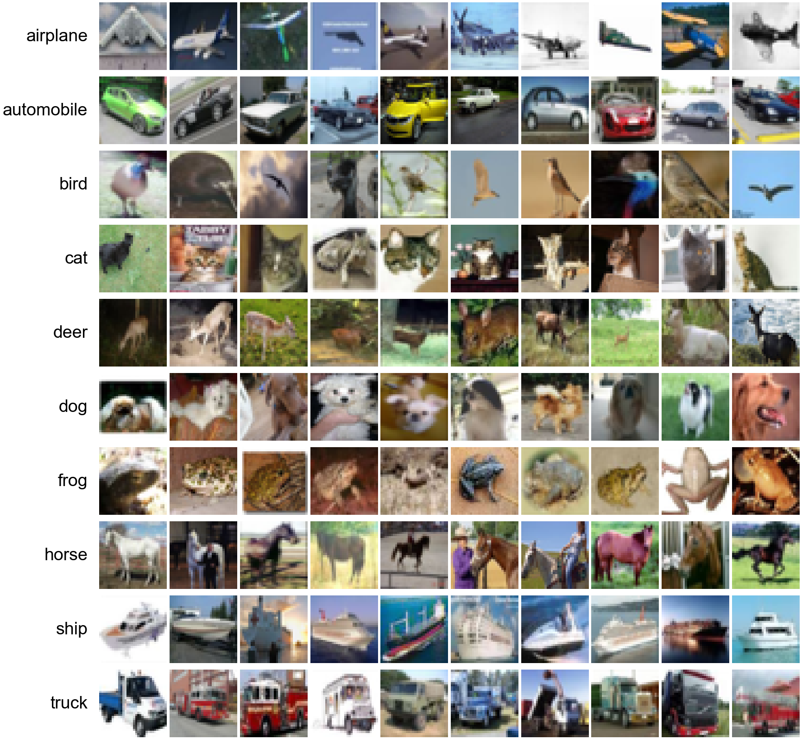
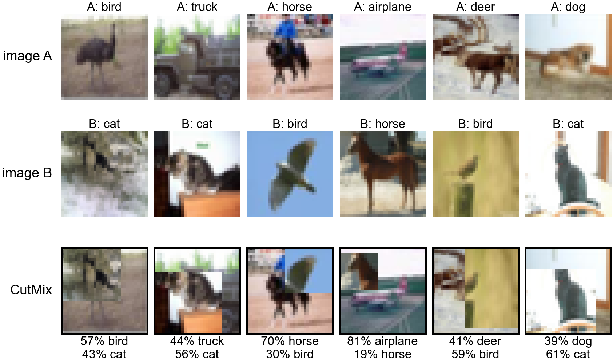
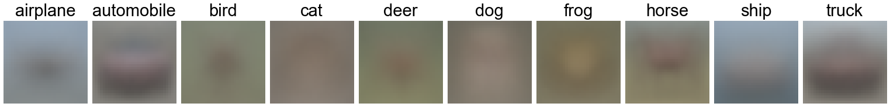
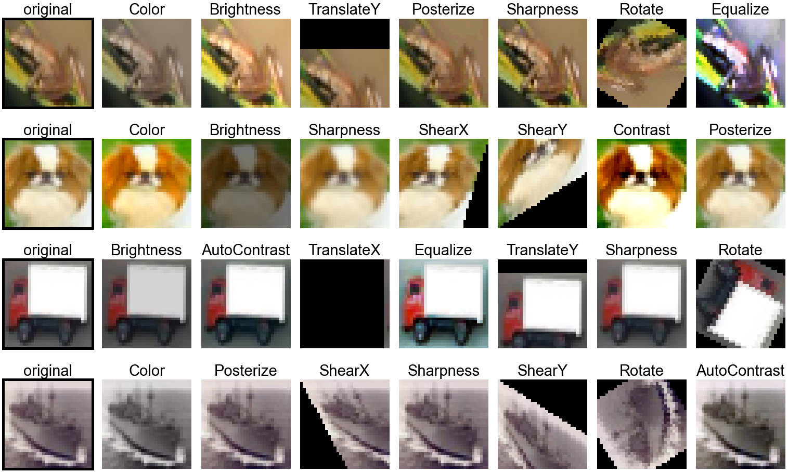
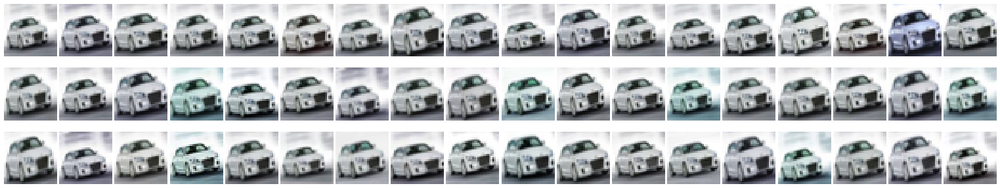
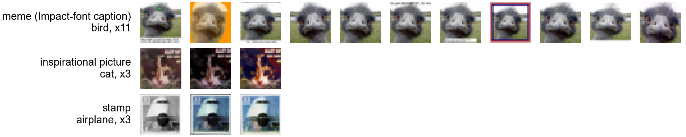

# Data, Augmentation and Covariate Shift (draft)

Each datum is an RGB, 32×32 image of a blurred but mostly recognizable subject. There are 10 categories with 5,000 training images each, along with 2,000 unlabeled test images. Some classes can be very visually similar to one another, such as horses and deer, cats and dogs, cars and trucks, and planes, ships and birds, all often set against a blue background of sky or water.

*Figure: Ten random training images per class (32×32, RGB).*

These images can be adjusted before being sent into the neural network, using real-world intuition and knowledge of how neural networks learn. The adjustments (augmentations) are re-drawn at every pass through the training set (epoch), with random choices of whether and how each one is applied. The model therefore rarely sees the same version of an image twice, and learns the object itself rather than incidental details.

DeGrave et al. (2021) found that COVID-19 detectors trained on chest X-rays relied on shortcuts such as text markers and patient positioning rather than the lungs themselves, and failed on X-rays from other hospitals. Backgrounds pose the same risk here: many plane and bird images show a blue sky, but some do not, and a model that has learned "blue sky" instead of the object will misclassify those. To address this we used CutMix, which pastes a patch of one image into another and mixes the labels by area, so that no single region, background included, reliably predicts the class. We apply CutMix to a random half of all training batches, with a new patch size, position and partner image each time.

*Figure: A rectangular patch from image B replaces the same region in image A.*

Similar to background cues, the position of an object can also act as a shortcut to learning. The location of an 'object' in an image can often be determined from simple edge information, and in this dataset, some classes have common placements of objects. Cars, for example, are generally in the center of the frame (Figure: class means), meaning the rarer off-center car would be more difficult to learn. As such, we apply a random crop: each image is padded by 4 pixels on every side and a random 32×32 window is taken, shifting the object up to 4 pixels in any direction. We mirror the edge pixels into the padding rather than applying a fixed black border, as that border could be learned as well. Finally, we apply a horizontal flip to half of the images (but not a vertical flip), since objects in this dataset look the same mirrored left to right but not upside down. The random choices for all of the above are redrawn every epoch.

*Figure: Mean training image per class.*

These augmentations are intuitive, as each targets a specific failure mode: a shortcut feature (spurious correlation) the model could learn in place of the object. TrivialAugment (Müller & Hutter, 2021) is a generalization of this idea, where each image receives a single operation chosen at random from a fixed set (rotation, shear, translation, brightness, contrast, color, sharpness, posterize, solarize, and others), applied at a random strength. These changes don't necessarily represent issues present in the data, but they harden the model. No single cue (color, contrast, orientation, texture) remains reliable throughout training, so the model has to use all of them together rather than depend on any one. A new operation and strength is drawn for every image, applied before the crop and flip. Each epoch, every image is used twice in the same batch, each copy augmented independently (Hoffer et al., 2020).

*Figure: Examples of TrivialAugment operations at random strengths.*

This idea can also be applied in reverse at test time. Rather than relying on one test prediction, we can feed several augmented versions of an image into the network and average the predicted output distributions. This is test-time augmentation (TTA). At test time we fed an image and its horizontal mirror into the network.

Understanding these augmentation techniques, we were able to identify non-pixel-perfect duplicates within the training set: the same photo appearing again mirrored, zoomed, cropped, re-tinted, framed or captioned. We identified these near duplicates without training a model. First, in a coarse pass, every image was reduced to a 16×16 grayscale thumbnail with its brightness and contrast normalized, and compared with every other image under mirror, zoom and crop transformations, which produced candidate pairs. We then verified these candidates at full resolution by comparing their edge structure. The thresholds for both steps were tuned iteratively by visually inspecting borderline pairs. As a result we found at least 759 duplicate pairs forming 468 groups, covering 1,086 images (2.2% of the training set).

*Figure: All 54 copies of one training image (automobile).*

Many of these groups are late-2000s internet memes, such as images with Impact-font captions, inspirational pictures and stamps, and some copies have their backgrounds cut out or a border added.

*Figure: Duplicate groups that are late-2000s internet memes.*

These repeated images were not removed from the training set, as they still carry additional information, but when splitting the training set for k-fold validation we kept every duplicate group together, so that validation scores would not be inflated by memorization.

Now with the images inspected qualitatively, we must make some quantitative adjustments. Analyzing the statistics of the test set, we can see that it is not drawn from the same distribution as the training set: test images are brighter and higher in contrast, and contain about three times as many grayscale images.

| Statistic (R / G / B) | Train (50,000) | Test (2,000) | Difference |
|---|---|---|---|
| Mean (brightness) | 0.491 / 0.482 / 0.447 | 0.513 / 0.498 / 0.461 | +4.4% / +3.2% / +3.3% |
| Standard deviation (contrast) | 0.247 / 0.244 / 0.262 | 0.265 / 0.262 / 0.275 | +7.2% / +7.7% / +5.2% |
| Grayscale images | 1.16% (582) | 3.45% (69) | 3.0× |

As such, the test set likely does not come from the same distribution as the training set. The statistics of the training set match the published CIFAR-10 values. The Kolmogorov–Smirnov (KS) test compares two samples by measuring the largest gap between their cumulative distributions, and its value was statistically significant everywhere, meaning the test set is likely not drawn from the standard CIFAR-10 data.

We normalize each color channel using the mean and standard deviation of the training set:

$$x' = \frac{x - \mu_c}{\sigma_c}$$

where $\mu_c$ and $\sigma_c$ are the training mean (brightness) and standard deviation (contrast) of channel $c$. Test images are normalized with the same training values, so the shift measured above remains after normalization. To cover it, the brightness and contrast operations of TrivialAugment expose the model during training to a range of exposures wider than the gap between the two sets. It can also be considered to convert the RGB values into another color space, such as separating chroma from brightness (e.g. YCbCr), but these are linear transformations of RGB that the network can learn on its own, so we do not apply them.

This shift may explain why models validate better than they test. Held-out images drawn from the training set share its statistics, so validation accuracy measures performance on the training distribution rather than the test distribution. Recht et al. (2019) observed this effect on a newly collected CIFAR-10 test set: classifiers lost 4–10 points of accuracy, while their relative ranking was largely preserved. Validation therefore remains useful for comparing design choices, but not for predicting test accuracy.

## References

- DeGrave, A. J., Janizek, J. D., & Lee, S.-I. (2021). AI for radiographic COVID-19 detection selects shortcuts over signal. *Nature Machine Intelligence*, 3, 610–619.
- Hoffer, E., Ben-Nun, T., Hubara, I., Giladi, N., Hoefler, T., & Soudry, D. (2020). Augment your batch: Improving generalization through instance repetition. *CVPR*.
- Krizhevsky, A. (2009). Learning multiple layers of features from tiny images. Technical report, University of Toronto.
- Müller, S. G., & Hutter, F. (2021). TrivialAugment: Tuning-free yet state-of-the-art data augmentation. *ICCV*.
- Recht, B., Roelofs, R., Schmidt, L., & Shankar, V. (2019). Do ImageNet classifiers generalize to ImageNet? *ICML*.
- Yun, S., Han, D., Oh, S. J., Chun, S., Choe, J., & Yoo, Y. (2019). CutMix: Regularization strategy to train strong classifiers with localizable features. *ICCV*.
